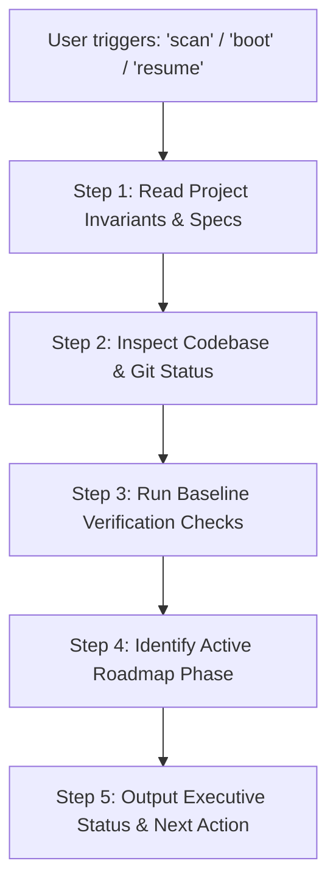

# BOOTSTRAP.md — Autonomous Session Onboarding & State Recovery

> **WearID** — *Your clothing identity, everywhere.*  
> Fast-boot protocol for any new Antigravity instance, switch of user account, or fresh chat session.

---

## 1. Quick-Start Triggers

Whenever a user switches accounts or opens a fresh conversation in this repository and sends **any** of the following prompts:

- `boot`
- `scan`
- `sync`
- `resume`
- `scan the file` / `scan the project`

The agent must **immediately execute the 5-Step Reconnaissance & Resume Protocol** below without asking unnecessary questions or awaiting further instructions.

---

## 2. The 5-Step Autonomous Reconnaissance Protocol



### Step 1: Ingest Governance & Architectural Context
Read the foundational specification documents in the repository root:
1. [**`AGENTS.md`**](file:///e:/Projects/WearID/AGENTS.md) — The 10 core invariants (never invent measurements, canonical `mm`/`g`, privacy by default, explainability, etc.).
2. [**`roadmap.md`**](file:///e:/Projects/WearID/roadmap.md) — Current chronological phase and vertical task slices.
3. [**`architecture.md`**](file:///e:/Projects/WearID/architecture.md) — Component architecture, domain models, and data flows.
4. [**`tests.md`**](file:///e:/Projects/WearID/tests.md) — Quality gates, test matrices, and definition of done.
5. [**`system.md`**](file:///e:/Projects/WearID/system.md) / [**`agents.json`**](file:///e:/Projects/WearID/agents.json) — Active agent personas and operational boundaries.

### Step 2: Inspect Workspace & Codebase State
Run non-destructive discovery commands to evaluate file structure and git history:
- Inspect workspace root and `src/` directory to see what modules currently exist.
- Run `git status` to identify modified, staged, or untracked files.
- Run `git log -n 5 --oneline` to review recent work and commits.

### Step 3: Run Baseline Verification Checks
Execute tests to establish whether the codebase is currently green or broken:
- If package configuration exists (`package.json`), run the verification command specified in `tests.md` (e.g. `npm test` or `npm run typecheck`).
- If no tests exist yet, confirm the project is in **Phase 1: Foundation & Canonical Core** of `roadmap.md`.

### Step 4: Locate Exact Milestone & Next Task Slice
Open [**`roadmap.md`**](file:///e:/Projects/WearID/roadmap.md) and scan for the first uncompleted task slice (`- [ ]`):
- Determine the active Phase (e.g. Phase 1, Phase 2, etc.).
- Determine the specific task slice ID (e.g. `1.1 Scaffolding`, `1.2 Domain Models`, `1.3 Unit Normalizer`).
- Identify the persona responsible for that slice (e.g. `sizing-engine`, `backend-engineer`).

### Step 5: Deliver Instant Executive Briefing
Reply to the user with a concise, structured briefing:
```markdown
### WearID State Synchronized
- **Active Phase**: Phase X: [Phase Name]
- **Current Milestone Slice**: Task X.Y: [Task Name]
- **Codebase Health**: [e.g. Clean / Tests Passing (XX/XX) / Greenfield]
- **Active Persona**: [e.g. Sizing & Fit Algorithm Specialist]

**Next Immediate Action:**
[1-2 sentences stating the exact code or test file being implemented next].
Proceeding with implementation now.
```
Then, proceed directly into executing that next task slice.

---

## 3. Grounding Rules for Any Fresh Agent Instance

1. **Never Re-Ask What WearID Is:** WearID is the sovereign clothing identity and deterministic sizing engine.
2. **Never Overwrite Completed Milestones:** Respect checked boxes (`- [x]`) in `roadmap.md`.
3. **Never Synthesize Size Charts:** If brand dimensions are needed during your work, follow Rule 1 of `AGENTS.md`.
4. **Always Stay in the Active Phase:** Do not skip ahead to frontend or integrations if core sizing algorithms or domain schemas in earlier phases are incomplete.
