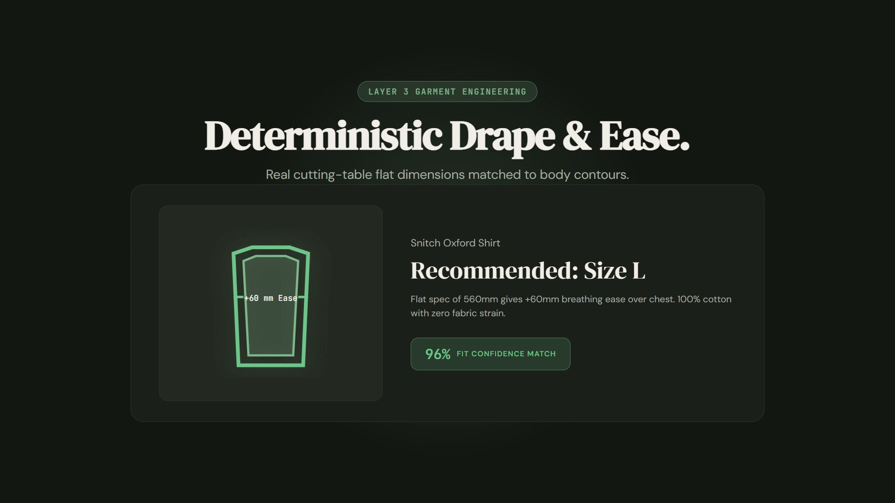

# WearID — Sovereign Clothing Identity & Deterministic Fitting

> **Your clothing identity, everywhere.**  
> Universal clothing identity, deterministic body-to-garment fitting, and sovereign measurement portability.

[](file:///tests.md)
[](https://www.typescriptlang.org/)
[](https://nextjs.org/)
[](https://tailwindcss.com/)
[](#)

---

## 🎬 Product Launch Overview

https://github.com/user-attachments/assets/brag-video

<p align="center">
  <video src="brag-output/brag.mp4" poster="brag-output/brag.jpg" width="100%" controls autoplay loop muted playsinline>
    
  </video>
</p>

*Watch the official launch video ([`brag.mp4`](file:///brag-output/brag.mp4)) showcasing WearID's end-to-end sovereign biometric passport, couture lingerie visualizer, and deterministic ease engine.*

---

## 🌟 Key Capabilities

### 1. Sovereign Biometric Passport (Layer 1)
- **Millimeter-Precision Biometrics:** Human dimensions stored strictly as canonical integer millimeters (`mm`) and mass in grams (`g`).
- **Cryptographic Privacy by Default:** Local client-side AES-256-GCM encryption at rest. Zero anatomical biometrics leaked to third parties without explicit user consent.
- **Multi-Member Profile Management:** Seamlessly manage measurements for self, partner, and family.

### 2. Deterministic Fitting Engine (Layers 2 & 3)
- **Layer 3 Flat Garment Dimensions:** Evaluates finished textile dimensions laid flat (pit-to-pit, waist, shoulder, sleeve, rise, inseam).
- **Layer 2 Brand Body Fit Charts:** Ingests official brand size charts with immutable provenance verification (`source_type`, `source_uri`, `retrieved_at`, `verification_hash`).
- **Gaussian Fit Scoring:** Uses mathematical ease distributions ($\sigma$) to score breathing comfort across Slim, Regular, Relaxed, and Oversized cuts.
- **Invariants 1 & 2 Enforced:** Zero synthetic measurements, zero hallucinated size charts.

### 3. Interactive Visualizer Suite
- **Intimate Apparel & Bra Sizing Visualizer:**
  - Dynamic 3D cup projection scaling with anatomical underwire curvature.
  - Real-time ribcage underband tension and sternum gore contact checks.
  - Sister-size volume equivalency matrix (same cup cubic volume across alternative band sizes).
- **Proportional Anatomical Silhouette (`BodySilhouetteCanvas`):**
  - Interactive landmark inspection (Shoulders, Chest Girth, Natural Waist, High Hips, Inseam).
  - Morphological classification (V-Taper, Balanced, Lean, Robust).
- **2D Garment Drape & Ease Silhouette (`GarmentDrapeOverlay`):**
  - Superimposed body contour vs. finished textile outline.
  - Color-coded ease halos (Tension Red $\rightarrow$ Snug Amber $\rightarrow$ Ideal Forest Green $\rightarrow$ Loose Amber).
- **5-Axis Fit Polygon Radar (`FitRadarChart`):**
  - Polar coordinates across Chest, Waist, Shoulders, Length, and Sleeve.
  - Interactive vertex inspection chips displaying exact ease delta.

### 4. Sovereign Tailor Card & Portability SDK
- **Digital Tailor Card:** Instant QR code and WhatsApp share card with formatted imperial/metric dimensions for custom tailors and master cutters.
- **E-Commerce Sandbox:** Embeddable zero-knowledge sizing token widget demonstrating 1-click checkout size recommendation for third-party merchants without revealing body measurements.

---

## 🗂️ Verified Brand Catalog

WearID's brand database is backed by verified brand size charts and flat garment specifications:
- **Intimates & Bras:** Uniqlo 3D Hold Wireless Bra, Marks & Spencer Total Support Underwired Bra, Nike Swoosh Medium-Support Sports Bra.
- **Bottoms & Pants:** Levi's 501 Original Fit Rigid Denim Jeans, Uniqlo Slim Fit Chino Pants.
- **Outerwear & Jackets:** Levi's Classic Trucker Denim Jacket, Uniqlo Ultra Light Down Jacket.
- **Tops & Shirts:** Uniqlo Oxford Slim Fit Shirt, Uniqlo AIRism Cotton Oversized Tee, Snitch Heavyweight Boxy Tee, Zara Textured Tee.

---

## 🛠️ Tech Stack & Architecture

- **Framework:** Next.js 14 (App Router)
- **Language:** TypeScript 5.7 (Strict Mode)
- **Styling:** Tailwind CSS with Warm Editorial Design Tokens (Ivory `#F5F3ED`, Forest Green `#425B48`, Terracotta `#C38367`, Dark `#141613`)
- **State Management:** Zustand with LocalStorage Persistence
- **Security:** Web Crypto AES-256-GCM, Zod Schema Validation
- **Testing:** Vitest 2.1 (474 tests across 22 test suites)
- **PWA:** Service Worker offline cache with native install prompts

---

## 🚀 Quickstart

### 1. Install Dependencies
```bash
npm install
```

### 2. Run Test Suite
```bash
npm test
```

### 3. Start Development Server
```bash
npm run dev
```
Open [http://localhost:3000](http://localhost:3000) in your browser.

### 4. Build for Production
```bash
npm run build
```

---

## 🔒 Verification & Quality Certification

| Check | Tool | Status |
|:---|:---|:---:|
| **Type Integrity** | `tsc --noEmit` | **PASS (0 errors)** |
| **Linting** | `eslint` | **PASS (0 warnings)** |
| **Unit & E2E Tests** | `vitest` | **PASS (474/474 tests)** |
| **Production Build** | `next build` | **PASS (26/26 routes)** |

---

## 📄 License & Governance

Operated under strict governance rules in [`AGENTS.md`](file:///AGENTS.md). All measurements retain end-to-end source provenance.
