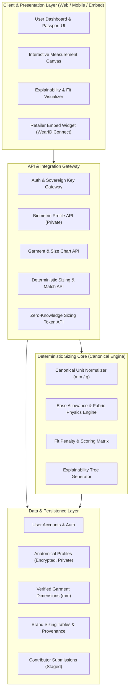
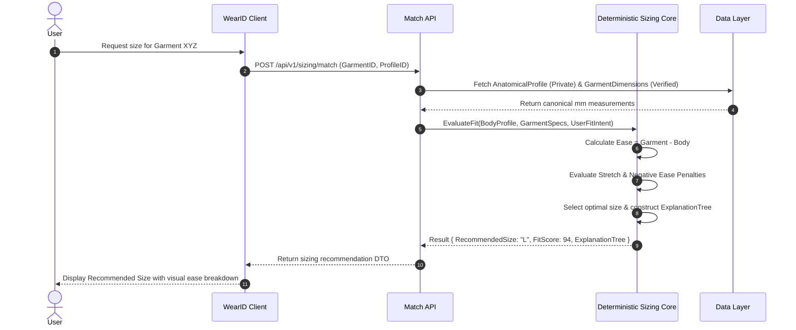
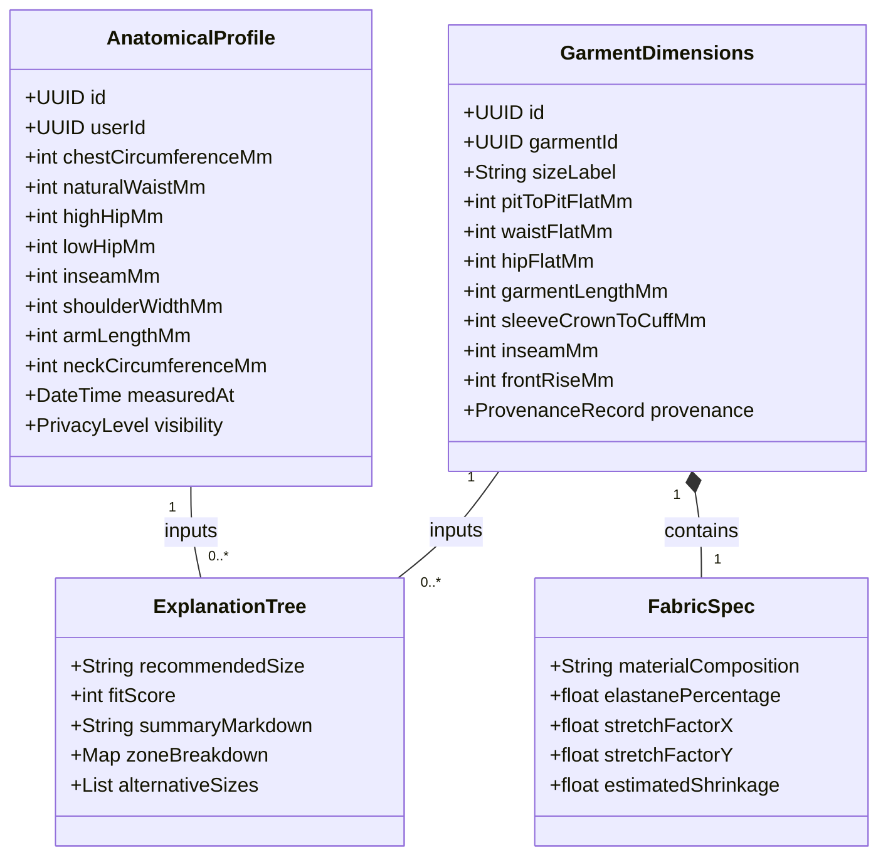

# architecture.md — State & System Architecture Blueprint

> **WearID** — *Your clothing identity, everywhere.*  
> Technical architecture, data flow, component dependencies, and domain boundaries.

---

## 1. High-Level System Architecture

WearID is designed as a sovereign, privacy-preserving clothing identity platform and deterministic sizing engine. It decouples human anatomical dimensions from apparel retailer specifications, enabling users to carry their clothing identity anywhere.

---

## 2. Core Subsystems

### 2.1 Identity & Sovereign Profile Subsystem
- **Purpose:** Manages user authentication, privacy configurations, and personal anatomical body measurements.
- **Key Entities:**
  - `User`: Core authentication record, sovereign encryption keys.
  - `AnatomicalProfile`: Strict human body dimensions in canonical `mm` (chest circumference, waist, hip, inseam, shoulder width, sleeve span, neck).
  - `FitPreferences`: Subjective user fit preference per category (e.g., `shirt: relaxed`, `jeans: tailored`, `outerwear: oversized`).
- **Privacy Barrier:** Raw anatomical profiles are encrypted at rest and never returned over public or retailer APIs.

### 2.2 Catalog & Ingestion Subsystem
- **Purpose:** Ingests, validates, and stages brand sizing charts and garment dimension specifications.
- **Key Entities:**
  - `Brand`: Brand identity, official size designation guidelines.
  - `Garment`: Specific garment model, textile composition (`% cotton`, `% elastane`, etc.), shrinkage expectations.
  - `GarmentDimensions`: Flat and 3D finished garment measurements in canonical `mm` (pit-to-pit, waist flat, outseam, rise, thigh flat).
  - `ProvenanceRecord`: Immutable audit record of source URL, retrieval timestamp, verification hash, and author.
  - `StagingQueue`: Unverified contributor or scraped submissions pending human review or multi-source corroboration.

### 2.3 Deterministic Sizing Core Engine
- **Purpose:** Pure functional mathematical engine that matches an `AnatomicalProfile` with `GarmentDimensions`.
- **Pipeline:**
  1. **Canonical Normalization:** Input dimensions converted to integer millimeters (`mm`).
  2. **Ease Calculation:**
     $$\text{Total Ease} = \text{Garment Circumference} - \text{Body Circumference}$$
     $$\text{Required Minimum Ease} = \text{Wearing Ease} + \text{Design Ease} - \text{Fabric Stretch Factor}$$
  3. **Tolerance & Penalty Evaluation:** Evaluates critical zones (Chest, Waist, Hip, Shoulder). Severe penalties applied for negative ease on rigid fabrics.
  4. **Size Classification:** Scores available sizes (XXS to 5XL / numeric waist-inseam) and selects best-fit size.
  5. **Explainability Generation:** Assembles a structured `ExplanationTree` detailing exactly why the size was chosen, the ease delta for each zone, and fabric considerations.

### 2.4 Portability & Retailer Gateway (WearID Connect)
- **Purpose:** Enables e-commerce stores to embed WearID buttons to recommend sizes without accessing customer body data.
- **Zero-Knowledge Token Protocol:**
  - User generates a scoped `WearID Token` for a specific session/cart.
  - Retailer API calls `/api/v1/portability/recommend` with `{ token, retailer_sku }`.
  - WearID server matches in-memory and returns `{ recommended_size: "L", confidence: 0.95, fit_tag: "tailored" }`.
  - **Zero biometric dimensions** are ever sent to the retailer.

---

## 3. Data Domain Models & Structural Segregation

---

## 4. State Management & Context Trees

### Frontend State Flow
- **Global Auth & Identity Context:** Current user credentials, sovereign key pair status, active profile ID.
- **Measurement Profile Context:** Local cache of user's canonical body measurements, unit preferences (`in` vs `cm`), and active fit intentions.
- **Garment Explorer Context:** Currently inspected garment, verified dimension tables, selected color/fabric variation.
- **Recommendation Result State:** Cached sizing matches with detailed `ExplanationTree` payloads for instant rendering.

---

## 5. Architectural Boundaries & Cross-Component Invariants

1. **Strict Dependency Direction:**
   - Client Layer $\rightarrow$ API Gateway $\rightarrow$ Core Engine $\rightarrow$ Data Persistence.
   - Core Engine has **zero** dependencies on HTTP, UI frameworks, or database drivers (Pure TypeScript / standard library).
2. **Canonical Data Boundary:**
   - All models at REST boundary accept preferred display units but immediately normalize to canonical `mm` and `g` upon entering domain services.
3. **Staging Isolation:**
   - Unverified contributor submissions are written to an isolated table `staged_contributions` and can never be read by the production recommendation query path until explicitly signed and approved.
