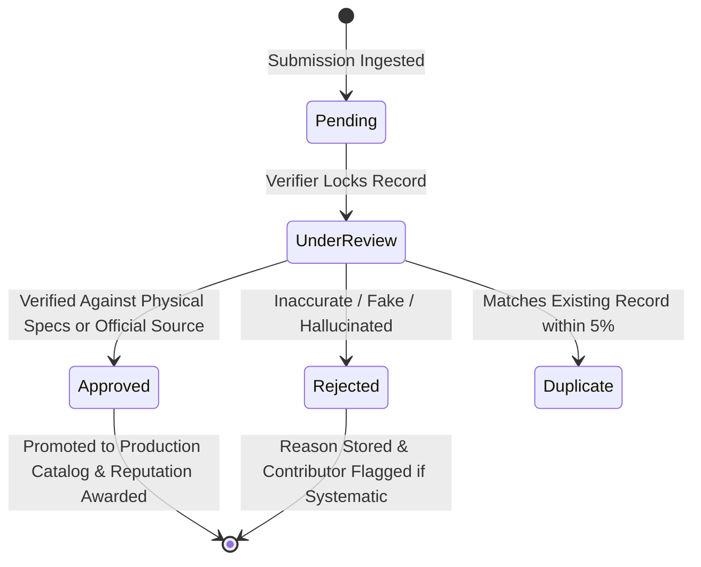

# docs/admin-workflow.md — Admin Moderation & Data Verification Workflow

> **Fit / WearID — Universal Clothing Size Profile**  
> Operational procedures for vetting community submissions, reviewing scraped brand updates, reputation points, and anti-abuse safeguards.

---

## 1. Staging Lifecycle

All data from community contributors or web crawlers enters an isolated staging table (`community_contributions`) before affecting the production catalog.



---

## 2. Hard Verification Rules for Reviewers

1. **Self-Verification Prohibition:**
   A verifier or admin can **never** verify their own submission. Enforced at the database schema level:
   ```sql
   CONSTRAINT cannot_verify_own_submission CHECK (contributor_id <> reviewed_by)
   ```
2. **Provenance Proof Required:**
   Submissions must include direct URL evidence, physical photo of the garment label/measuring tape, or verified technical sheet.
3. **Canonical Normalization Check:**
   Reviewers verify that numbers are entered in canonical millimeters (`mm`) or valid centimeters (`cm`) without estimation.
4. **Anti-Abuse & Demotion:**
   Contributors who submit systematically distorted numbers are flagged, have reputation points stripped, and lose contribution privileges.
