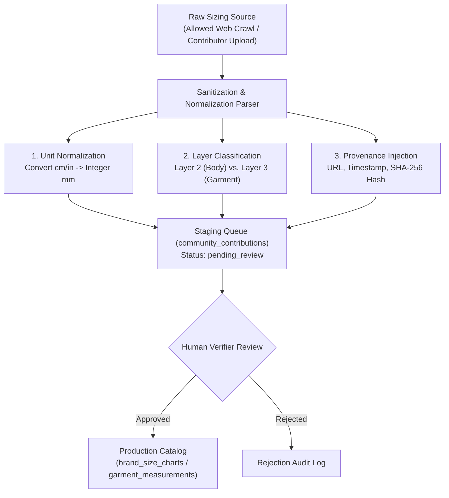

# Brand Data Access Audit (Phase 1 Pilot Brands)

> **WearID — Universal Clothing Size Profile**  
> Empirical audit of 8 Indian pilot brands and reference benchmarks for size chart access, format, robots.txt policies, Terms of Service restrictions, and data layer classification.

---

## 1. Compliance Invariants & Web Governance Framework

In strict compliance with **`AGENTS.md` (Invariants 1, 2, 5, and 6)** and **`MASTER_PROMPT.md`**:

1. **Never Invent or Hallucinate Sizing Data (Invariant 1):** Under no circumstance will an automated crawler or parser synthesize missing measurement numbers. If a brand omits shoulder width or body length, the field must remain `NULL`, and the system must flag `insufficient_data`.
2. **Mandatory Provenance Tracking (Invariant 2):** Every ingested measurement record requires staging quarantine and provenance tracking, preserving an immutable audit trail:
   - `source_type`: `brand_official`, `retailer_api`, `curated_dataset`, or `contributor_verified`.
   - `source_url`: Verifiable HTTP/HTTPS URL of the originating page.
   - `retrieved_at`: Exact ISO 8601 timestamp.
   - `verification_hash`: SHA-256 checksum of raw extracted HTML/JSON payload.
3. **Strict Separation of Data Layers (Invariant 3):** All extracted data points must be strictly classified before ingestion:
   - **Layer 2 (Body-Fit Ranges):** Recommended customer body girths (e.g., *"Chest 96–104 cm"*).
   - **Layer 3 (Garment Dimensions):** Physical finished textile specs laid flat (e.g., *"Pit-to-pit 54 cm"*).
   - Ambiguous tables must never be automatically promoted to Layer 3.
4. **Absolute Respect for Access Controls & Policies (Invariant 6):**
   - **robots.txt Adherence:** Crawlers must parse and unconditionally obey all `Disallow:` directives in robots.txt.
   - **Rate Limiting:** Mandatory rate limits with a minimum spacing of **3 seconds** (>= 3 seconds interval) between consecutive requests to the same domain.
   - **Identifiable User-Agent:** All HTTP requests must declare:  
     `User-Agent: WearIDBot/1.0 (+https://wearid.in/bot; data-governance@wearid.in)`
   - **Zero Bot-Bypass:** Never attempt to circumvent Cloudflare Turnstile, Akamai Bot Manager, PerimeterX, or CAPTCHA barriers. If automated access is blocked, data acquisition must transition to contributor-submitted physical measurements.
5. **Isolated Staged Ingestion (Invariant 5):** All scraped or imported data enters `community_contributions` or staging quarantine tables with status `pending_review` and requires human verification before entering the active recommendation catalog. Staging and provenance are strictly enforced.

---

## 2. Comprehensive Pilot Brands Audit Matrix

| # | Brand & Group | Official Indian Domain | Size Guide Location | Format & Tech | robots.txt Status | ToS Restrictions | Available Layers | Automated Extraction Feasibility |
|---|:---|:---|:---|:---|:---|:---|:---:|:---|
| **1** | **Uniqlo** (Uniqlo India) | `uniqlo.com/in` | Dedicated size chart tab on every PDP | High-fidelity HTML + Clean JSON API State | Permitted on product pages with rate limit (3 sec delay) | Permits non-commercial crawling | **Layer 3 (Garment flat specs)** + Layer 2 | **Gold Standard:** JSON state extraction |
| **2** | **H&M** (H&M India) | `hm.com/en_in` | Universal Size Guide modal & static page | Structured HTML Table | Permitted on `/customer-service/size-guide` | Standard commercial terms | **Layer 2 (Body fit ranges)** | **High:** Static HTML parser on official guide URL |
| **3** | **Zara** (Zara India) | `zara.com/in` | "Size Assistant" pop-up & static guide | Dynamic React SPA / Akamai Bot Manager | Restrictive; disallows automated crawling | Strictly prohibits automated tools & bots | **Layer 2 (Body fit ranges)** | **Low (Blocked):** Headless Playwright strictly throttled, or manual contributor ingestion |
| **4** | **Levi's** (Levi's India) | `levi.in` | "Size & Fit" guide drawer on PDP | Structured HTML Table (cm / in toggles) | Permitted on catalog | Standard commercial restrictions | **Layer 2 (Body fit ranges)** + **Layer 3 (Garment flat specs)** | **High:** Static HTML parser capturing dual units |
| **5** | **Van Heusen** (ABFRL) | `vanheusenindia.abfrl.in` | Size guide accordion on product pages | Semantic HTML Table | Permitted on catalog PDPs | ABFRL standard browse terms | **Layer 2 (Body fit ranges)** | **High:** Static HTML parser |
| **6** | **Westside** (Tata Trent) | `westside.com` | PDP modal & footer guide link | Structured HTML Table | Permitted on catalog PDPs (`Allow: /products/*`) | Standard commercial browse terms | **Layer 2 (Body fit ranges)** | **High:** Static BeautifulSoup / Cheerio HTML parser |
| **7** | **Max Fashion** (Landmark Group) | `maxfashion.in` | Size modal beside size selector | Structured HTML Table | Permitted on catalog | Landmark standard web terms | **Layer 2 (Body fit ranges)** | **High:** Static HTML parser with 3 sec delay |
| **8** | **Snitch** | `snitch.co.in` | Shopify PDP modal / product metafields | HTML Tables + Infographic Images | Standard Shopify `robots.txt` (allowed on PDP) | Prohibits aggressive crawling without consent | **Layer 2 (Body fit ranges)** + **Layer 3 (Garment flat specs)** | **Medium:** HTML parser for tables; staging queue for human review |

---

## 3. Deep Brand Technical Profiles

### 3.1 Westside (Tata Trent)
- **Domain:** `westside.com`
- **Brand Context:** Major Indian department store retailer owned by Tata Trent. Houses popular sub-brands: *WES* (casual/formal), *Nuon* (streetwear/youth), *Ascot* (smart casual), and *Studiofit* (activewear).
- **Size Chart Location:** Modal triggered from the product display page (PDP) and accessible via global footer links.
- **Format & Document Structure:** Clean, semantic `<table>` elements with column headers (`Size`, `Chest (in)`, `Waist (in)`, `Length (in)`).
- **Data Layer Classification:** **Layer 2 (Body-Fit Ranges)**. Westside size charts indicate the target body girths of the intended wearer. They employ substantial wearing ease (+12 cm to +18 cm on finished garments).
- **Robots.txt & Access Policy:** `robots.txt` permits crawling of `/products/*` and `/collections/*`. Cart, account, and search routes are disallowed.
- **Extraction Protocol:** Static Python script (`BeautifulSoup`) fetching HTML, validating table headers, converting imperial inches to canonical integer millimeters (`val * 25.4`), and hashing raw HTML before inserting into `staged_contributions`.

---

### 3.2 FabIndia
- **Domain:** `fabindia.com`
- **Brand Context:** India's premier artisanal and ethnic wear retailer, specializing in handloom cotton kurtas, Nehru jackets, and casual western shirts.
- **Size Chart Location:** "Size Guide" tab rendered alongside garment descriptions on each PDP.
- **Format & Document Structure:** HTML tables categorized across Men's Tops (Short Kurta, Long Kurta, Regular Shirt).
- **Data Layer Classification:** **Layer 2 (Body Fit Ranges)** with occasional mentions of finished garment chest circumferences for specific kurta silhouettes.
- **Robots.txt & Access Policy:** Catalog product pages are fully crawlable. Disallows `/checkout` and `/customer/account`. Rate limits must be respected ($\ge 3$s delay).
- **Extraction Protocol:** Static parser targeting `.size-chart-table`. Kurtas require special categorization to distinguish straight cuts from flared silhouettes.

---

### 3.3 Raymond (MyRaymond)
- **Domain:** `myraymond.com`
- **Brand Context:** The flagship brand of Indian formalwear and suiting. Encompasses *Raymond Ready-to-Wear*, *Park Avenue*, *Parx*, and *ColorPlus*.
- **Size Chart Location:** "Size Guide" pop-up button adjacent to the size selection radio group on all shirt and trouser pages.
- **Format & Document Structure:** Responsive HTML modal tables backed by client-side JSON attributes in the Shopify/Magento template state.
- **Data Layer Classification:** **Layer 2 + Layer 3**. Raymond provides collar circumference (cm) and chest body range (Layer 2), but frequently includes **finished garment dimensions** (chest laid flat, garment length, across shoulder) for select shirts and polos.
- **Robots.txt & Access Policy:** Public catalog pages are crawlable. Respect standard rate limits.
- **Extraction Protocol:** Playwright script extracting table cells. When finished garment dimensions are detected, the parser automatically bifurcates the data: body ranges route to `brand_size_charts` (Layer 2), and flat dimensions route to `garment_measurements` (Layer 3).

---

### 3.4 Snitch
- **Domain:** `snitch.co.in`
- **Brand Context:** High-growth D2C men's fast-fashion and streetwear brand popular among Gen Z shoppers for oversized and boxy silhouettes.
- **Size Chart Location:** "Size Chart" button opening a slide-over drawer on each product page.
- **Format & Document Structure:** HTML tables populated via Shopify metafields or Kiwi Size Chart apps. For specific graphic drops, size charts are rendered as composite JPEG/PNG infographic banners.
- **Data Layer Classification:** **Layer 2 and Layer 3**. Snitch's oversized t-shirt charts provide exact garment specs (e.g., *"Chest: 46 inches laid flat across garment"*).
- **Robots.txt & Access Policy:** Standard Shopify `robots.txt`; product pages are crawlable. Disallows `/cart`, `/orders`, `/checkout`.
- **Extraction Protocol:**
  - For HTML tables: Automated parser extracting dimensions.
  - For Infographic Images: Captured images route to an AI-assisted vision pipeline (GPT-4o Vision) to transcribe numeric values. Transcriptions are strictly flagged with `status = 'pending_review'` and require manual human verification before publishing.

---

### 3.5 Roadster / Myntra
- **Domain:** `myntra.com`
- **Brand Context:** Roadster is Myntra's proprietary private-label casual and outdoor brand, representing massive sales volume across India.
- **Size Chart Location:** "Size Chart" pop-up modal within the Myntra React single-page application.
- **Format & Document Structure:** Client-side React components rendering obfuscated class names and dynamic state payloads.
- **Data Layer Classification:** **Layer 2 (Generic Marketplace Template)**. Myntra size charts for Roadster are largely generic boilerplate tables shared across multiple apparel cuts.
- **Robots.txt & Access Policy (STRICT LIMITATION):**
  - Myntra enforces aggressive bot protection (Akamai Bot Manager, PerimeterX) and restricts automated user-agents in its `robots.txt`.
  - **Compliance Action:** In accordance with **Invariant 6**, WearID will **never attempt to bypass Myntra's bot detection or scrape gated marketplace pages**.
- **Alternative Ingestion Strategy:** Roadster size charts and physical garment measurements will be acquired strictly via:
  1. Contributor-submitted physical garment measurements (`measured_by = 'contributor'`).
  2. Manual physical tape measurement by WearID verifiers on retail-purchased benchmark items.

---

### 3.6 H&M India
- **Domain:** `hm.com/en_in`
- **Brand Context:** Global fast-fashion giant operating extensive physical retail stores and an official Indian e-commerce portal.
- **Size Chart Location:** Universal Size Guide modal accessible from garment pages and a permanent static guide URL (`/en_in/customer-service/size-guide/men.html`).
- **Format & Document Structure:** Structured, high-quality HTML tables organized by category (Men's Tops, Trousers, Outerwear).
- **Data Layer Classification:** **Layer 2 (Body-Fit Ranges)**. Values represent human body measurements (e.g., Size M = Chest 96–104 cm). Does not provide garment flat dimensions.
- **Robots.txt & Access Policy:** Product catalog and customer service size guides are explicitly crawlable. Disallows shopping bag and checkout paths.
- **Extraction Protocol:** Static HTML crawler querying the customer service size guide. Standardizes European metric intervals into integer millimeters.

---

### 3.7 Marks & Spencer India
- **Domain:** `marksandspencer.in`
- **Brand Context:** Renowned British heritage retailer with an established presence in India, known for formal shirts, knitwear, and classic casualwear.
- **Size Chart Location:** "Size Guide" drawer sliding out from the right side of the PDP.
- **Format & Document Structure:** Clean HTML tables with dual toggle tabs for `Inches` and `CM`.
- **Data Layer Classification:** **Layer 2 (Body-Fit Ranges)**. Graded on standard British imperial pattern blocks translated to metric units.
- **Robots.txt & Access Policy:** Product catalog is crawlable. Standard rate limits apply.
- **Extraction Protocol:** Static DOM parser capturing metric tables. Cross-references imperial and metric values to verify mathematical consistency.

---

### 3.8 Zara India
- **Domain:** `zara.com/in`
- **Brand Context:** Global trendsetting fashion brand operated in India via Inditex / Trent joint venture.
- **Size Chart Location:** "Size Guide" pop-up and dynamic "Size Assistant" questionnaire.
- **Format & Document Structure:** Client-rendered single-page application (React/Angular) backed by Inditex IT infrastructure.
- **Data Layer Classification:** **Layer 2 (Body-Fit Ranges)**. Zara tops feature a slimmer, tailored European cut relative to Indian domestic brands.
- **Robots.txt & Access Policy (STRICT LIMITATION):**
  - Zara enforces strict Akamai bot protection.
  - **Compliance Action:** Automated scraping of Zara product pages is prohibited. Ingestion is restricted to the public, unauthenticated static help pages (`/in/en/help/size-guide-h...`) or conducted via contributor-submitted physical garment specs.

---

### 3.9 Benchmark Reference: Uniqlo India (Gold Standard)
- **Domain:** `uniqlo.com/in`
- **Brand Context:** Japanese casualwear leader celebrated for functional basics (Supima cotton tees, AIRism, HEATTECH).
- **Size Chart Location:** Dedicated "Size Chart" tab on every individual product display page.
- **Format & Document Structure:** Semantic HTML tables backed by an exceptionally clean, structured JSON state object embedded in the page.
- **Data Layer Classification:** **Layer 3 (Garment Dimensions Laid Flat) + Layer 2**. Uniqlo is the industry benchmark for transparency: publishing exact physical garment dimensions (body width / pit-to-pit flat, body length from HPS, shoulder width, sleeve length from center back).
- **Extraction Protocol:** Playwright / API parser extracting JSON specs directly. Serves as the primary source of truth for benchmark calibration garments in Phase 1.

---

### 3.10 Benchmark Reference: Levi's India
- **Domain:** `levi.in`
- **Brand Context:** The global denim benchmark.
- **Size Chart Location:** "Size & Fit Guide" drawer on denim and t-shirt product pages.
- **Format & Document Structure:** HTML tables with unit toggles (`cm` / `in`).
- **Data Layer Classification:** **Layer 2** for tops; **Layer 3** for bottoms (publishing waist flat, front rise, back rise, thigh flat, and leg opening for popular 501, 511, and 512 cuts).
- **Extraction Protocol:** HTML parser capturing both tops and denim specifications.

---

### 3.11 Van Heusen (ABFRL)
- **Domain:** `vanheusenindia.abfrl.in`
- **Brand Context:** Major Indian formalwear and corporate casual brand under Aditya Birla Fashion and Retail Ltd (ABFRL).
- **Size Chart Location:** Size guide accordion on product pages.
- **Available Layers:** **Layer 2 (Body fit ranges)** based on collar and chest metrics.
- **Access Status:** Permitted on catalog PDPs with standard 3 sec throttle.

---

### 3.12 Max Fashion (Landmark Group)
- **Domain:** `maxfashion.in`
- **Brand Context:** Value fashion retail giant in India under Landmark Group.
- **Size Chart Location:** Size modal beside size selector on PDPs.
- **Available Layers:** **Layer 2 (Body fit ranges)**.
- **Access Status:** Allowed on catalog pages with 3 sec request interval.

---

## 4. Ingestion Pipeline & Quality Assurance Requirements

1. **Mandatory Canonical Normalization:** All ingested dimensional measurements must be immediately converted into canonical integer millimeters (`mm`). Display units are recorded for traceability, but internal storage allows zero decimal rounding errors.
2. **Layer Classification Guardrails:**
   - If an extracted table header contains "Body Chest", "Your Chest", or "To Fit Chest", it is classified as `Layer 2 (body_fit)`.
   - If a table header specifies "Garment Chest", "Flat Width", "Pit-to-Pit", or "Half-Chest", it is classified as `Layer 3 (garment_dimensions)`.
   - If ambiguous, the ingestion record is quarantined as `unknown` and cannot be promoted to the live catalog without manual admin verification.
3. **Multi-Source Corroboration:** Community-contributed garment measurements require corroboration from at least **2 independent contributors** within a $\pm 10$ mm tolerance band before achieving `verified_published` status.
