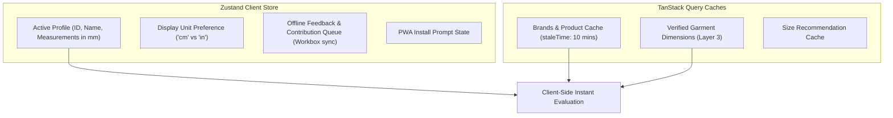

# docs/component-hierarchy.md — Component Hierarchy & UI Architecture

> **Fit / WearID — Universal Clothing Size Profile**  
> Visual structure, component hierarchy, client state management, and layout specifications for the Next.js App Router PWA.

---

## 1. Global Component Tree

```
src/app/
├── layout.tsx                   (Root HTML, Fonts: DM Sans & DM Serif, PWA Meta tags)
├── page.tsx                     (Public Editorial Landing Page)
├── onboarding/
│   ├── page.tsx                 (Three-Path Onboarding Coordinator)
│   ├── components/
│   │   ├── ProfileSetupStep.tsx
│   │   ├── PathSelector.tsx     (Quick / Garment-Derived / Full)
│   │   ├── GuidedTapeInput.tsx  (Inline SVG accordion guides)
│   │   ├── GarmentAnchorInput.tsx
│   │   └── FitPreferenceStep.tsx
├── app/
│   ├── layout.tsx               (Authenticated Dashboard Layout with persistent Profile Switcher)
│   ├── page.tsx                 (Dashboard Home: Search bar, quick recs, completeness nudge)
│   ├── search/
│   │   └── page.tsx             (Universal Brand & Garment Search with preview tags)
│   ├── recommend/
│   │   └── [brand]/[category]/
│   │       ├── page.tsx         (Large Size Display, Confidence Dot, Borderline Notice)
│   │       └── components/
│   │           ├── ExplanationTreeViewer.tsx (Per-dimension ease delta breakdowns)
│   │           ├── AlternativeSizeCard.tsx
│   │           └── FitFeedbackPrompt.tsx     ("Did this fit?" review form)
│   ├── profile/
│   │   ├── [id]/
│   │   │   ├── page.tsx         (Profile Details, Completeness Ring, Timeline History)
│   │   │   └── components/
│   │   │       ├── TailorExportModal.tsx (WhatsApp shareable card + QR code generator)
│   │   │       └── MeasurementHistoryDrawer.tsx
│   │   └── add/
│   │       └── page.tsx         (Add Family / Partner Profile with consent prompt)
│   ├── contribute/
│   │   └── page.tsx             (Community Contribution Forms & Points Ledger)
│   └── brands/
│       ├── page.tsx             (Directory of verified brands & data quality badges)
│       └── [slug]/
│           └── page.tsx         (Brand Size Chart & Garment Specification Viewer)
└── admin/
    └── page.tsx                 (Data Verification Queue & Brand Ingestion Manager)
```

---

## 2. Reusable Primitives (`src/components/ui/`)

Built strictly on the design system defined in `styles/tokens.css`:

| Component | Token Styling & Invariants |
| :--- | :--- |
| **`Card`** | `bg-surface`, `border: 1px solid var(--border)`, `rounded: 10px`, `shadow-sm`, hover lift `translateY(-2px)` |
| **`Button`** | Min-height `44px` (touch target), `rounded: 8px`, `font: DM Sans 500`. Variants: Primary (`--accent`), Secondary, Ghost, Destructive |
| **`Input` / `Select`** | Height `44px`, `border: 1.5px solid var(--border-strong)`, focus ring `2px solid var(--accent)` at 40% opacity |
| **`ConfidenceDot`** | `8px x 8px` rounded circle: Green (`>85%`), Amber (`65-85%`), Terracotta (`40-65%`), Muted Gray (`<40%`) |
| **`Badge`** | Pill shape `rounded-full`, `font: DM Sans 500`, uppercase `12px`, letter spacing `0.04em` |
| **`MeasurementAccordion`** | Inline SVG line-art guide with step-by-step instructions (no popup modals) |

---

## 3. Client State & Context Architecture (Zustand)



- **Unit Persistence:** All internal calculations use `mm`. When the user toggles `cm` or `in`, only display components re-render; no state recalculations or precision loss.
