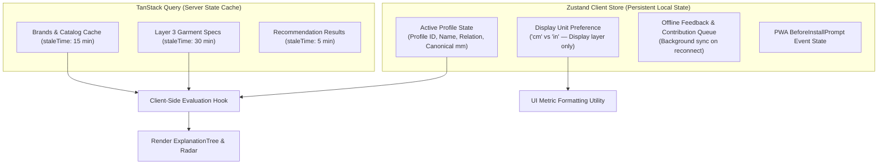

# Component Hierarchy & UI Architecture

> **WearID — Universal Clothing Size Profile**  
> Complete component hierarchy, visual layout tree, client state architecture, and mobile PWA interaction specifications.

---

## 1. Global Component Hierarchy Tree (Next.js App Router PWA)

```
AppRoot (src/app/layout.tsx)
 ├── ServiceWorkerRegistration (Offline Caching & Background Sync via Workbox)
 ├── ManifestLink (/public/manifest.json - Standalone PWA Display)
 ├── ThemeProvider (styles/tokens.css: Warm Ivory, Forest Green, Terracotta)
 ├── TanStackQueryProvider (Server Cache Management)
 ├── AuthProvider (Zustand Auth & Session Store)
 └── AppShell (src/components/layout/AppShell.tsx)
      │
      ├── TopNavigation (src/components/layout/TopNavigation.tsx)
      │    ├── BrandLogo ("WearID" — DM Serif Display)
      │    ├── Profile Switcher / ProfileSwitcher (Dropdown: Self, Partner, Family profiles)
      │    ├── UnitToggleSwitch (Real-time 'cm' <-> 'in' presentation toggle)
      │    └── OfflineIndicatorBadge (Visible when navigator.onLine is false)
      │
      ├── PageContainer (main - Responsive viewport container)
      │    │
      │    ├── View: /app (Dashboard Home / Passport)
      │    │    ├── PassportHeroCard (Active profile biometric summary)
      │    │    │    ├── ConfidenceIndicatorDot (High/Med/Low/Insufficient status)
      │    │    │    ├── PrimaryMetricsRow (Chest, Shoulders, Height, Fit Intent Tag)
      │    │    │    └── ExportPassportModal (QR Code, WhatsApp share, Tailor PDF)
      │    │    │         └── TailorCardView.tsx (Tailor card view & WhatsApp export)
      │    │    ├── QuickActionRow
      │    │    │    ├── MeasureNewGarmentButton (Triggers Garment Anchor Path)
      │    │    │    ├── FindSizeForProductButton (Navigates to Explorer)
      │    │    │    └── AddReferenceGarmentButton (Calibration Benchmark)
      │    │    ├── VerifiedPilotBrandsSlider (8 Pilot Brands Grid with data badges)
      │    │    └── RecentRecommendationsFeed (Cached past matches with deltas)
      │    │
      │    ├── View: /app/measure (onboarding / Measurement Canvas)
      │    │    ├── OnboardingPathSelector (3 Paths: Quick 2-min, From Garment, Tape)
      │    │    ├── PathSelector.tsx (Onboarding Path Selector: Quick / Garment-Derived / Full)
      │    │    ├── GarmentAnchorInput.tsx (Laid-flat garment anchor input)
      │    │    ├── InteractiveAnatomicalDiagram (Inline SVG body landmark guide)
      │    │    ├── StepByStepMeasurementWizard (React Hook Form + Zod)
      │    │    │    ├── ChestInputStep (with animated guide & 44px touch stepper)
      │    │    │    ├── ShoulderWidthStep (biacromial diameter visual cue)
      │    │    │    ├── TorsoLengthStep (HPS to waistband instruction)
      │    │    │    └── ReviewAndSaveStep (Displays canonical mm conversions)
      │    │    └── CanonicalUnitIndicator (Shows live integer mm stored value)
      │    │
      │    ├── View: /app/explore (Garment Catalog & Sizing Explorer)
      │    │    ├── CatalogSearchHeader (Search bar, brand filters, cut filters)
      │    │    ├── ProductCatalogGrid (Responsive 2-col mobile, 4-col desktop)
      │    │    │    └── ProductCard (Image, Brand Pill, Silhouette Tag, Match CTA)
      │    │    └── ProductDetailDrawer (Slide-over sheet with full tech-pack)
      │    │         ├── FabricSpecPill (100% Cotton, Elastane %, Stretch Level)
      │    │         ├── Layer3GarmentSpecTable (Chest Flat, Length, Shoulders in mm)
      │    │         └── EvaluateMatchButton (Invokes deterministic engine)
      │    │
      │    ├── View: /app/recommendation/[id] (Recommendation & Explainability UI)
      │    │    ├── PrimaryRecommendationHero
      │    │    │    ├── RecommendedSizeBadge (e.g., "Size L" — High visual prominence)
      │    │    │    ├── FitConfidencePill (e.g., "94% Confidence — High")
      │    │    │    └── BorderlineWarningBanner (Rendered if |score_0 - score_1| < 0.08)
      │    │    ├── FitRadarVisualizer (Tension zone gauge across Chest, Shoulder, Length)
      │    │    ├── ExplanationTreeCard
      │    │    │    ├── ConversationalSummaryMarkdown
      │    │    │    ├── DimensionBreakdownAccordion
      │    │    │    │    └── DimensionRow (Body mm vs Garment mm, Ease Delta, Status Pill)
      │    │    │    └── FabricDrapeConsiderationNote (Shrinkage & stretch analysis)
      │    │    └── ActionButtons
      │    │         ├── SaveRecommendationButton
      │    │         └── FeedbackModalTrigger ("Did This Fit?" outcome review modal)
      │    │
      │    └── View: /app/contribute (Community Staging Queue)
      │         ├── ContributorGuidelinesCard (Strict measurement protocols)
      │         ├── GarmentFlatMeasurementForm
      │         │    ├── ImageUploadDropzone (Tape measure on laid-flat garment photo)
      │         │    └── DimensionInputs (Pit-to-pit, length, shoulder in mm/cm)
      │         └── ContributionHistoryList (Status badges: Draft, Pending, Published)
      │
      └── BottomTabBar (src/components/layout/BottomTabBar.tsx)
           │-- Mobile Fixed Navigation Bar (44px min touch target, safe-area inset)
           ├── TabItem: Passport (/app)
           ├── TabItem: Measure (/app/measure)
           ├── TabItem: Explore (/app/explore)
           └── TabItem: Settings (/app/settings)
```

---

## 2. Reusable Primitives & Design System Mapping

All UI primitives are built strictly using the design system tokens defined in `styles/tokens.css`:

| Component | Styling & Token Reference | Mobile Accessibility Invariants |
|---|---|---|
| **`Card`** | Background `var(--surface)`, border `1px solid var(--border)`, border-radius `var(--radius-lg)` (`12px`), shadow `var(--shadow-sm)`. | Subtle tap-feedback elevation; touch-safe padding ($\ge 16$px). |
| **`Button`** | Height $\ge 44$px, border-radius `var(--radius-md)` (`8px`), font `var(--font-sans)` 500. Variants: Primary (`var(--accent)` forest green), Secondary, Ghost, Terracotta. | Minimum touch target bounding box **$44 \times 44$px** unconditionally. |
| **`Input` / `Select`** | Height $\ge 44$px, border `1.5px solid var(--border-strong)`, focus outline `2px solid var(--accent)` at 40% opacity. | `inputmode="decimal"` on mobile numeric keyboards; prevents auto-zoom on iOS (`font-size: 16px`). |
| **`ConfidenceIndicatorDot`** | Circle $8 \times 8$px. Green (`var(--success)` $\ge 85\%$), Amber (`var(--warning)` $65-85\%$), Terracotta (`var(--terracotta)` $40-65\%$), Gray ($<40\%$). | Includes accessible `aria-label` describing confidence level. |
| **`FitRadarVisualizer`** | SVG-rendered radar chart displaying ease status across anatomical zones: Chest (40%), Shoulders (35%), Length (15%). | Scalable SVG with high-contrast zone markers. |
| **`ExplanationTreeCard`** | Clean card displaying conversational markdown summary and collapsible accordion rows showing exact millimeter deltas. | Smooth CSS grid transitions for accordion expand/collapse. |
| **`BottomTabBar`** | Fixed bottom positioning with `padding-bottom: env(safe-area-inset-bottom)`. Background `var(--surface-elevated)` with top border `var(--border)`. | 4 items evenly spaced with minimum $48$px tap height. |

---

## 3. Client State & Cache Management (Zustand + TanStack Query)



### 3.1 Unit Normalization Architecture
- **Canonical Storage:** All numbers inside the Zustand store and database are **pure non-negative integer millimeters (`mm`)**.
- **Display Formatting:** The `useUnitFormatter` hook converts canonical millimeters to the user's preferred display unit on the fly:
  - If preferred unit is `cm`: $\text{Value (cm)} = \frac{\text{Value (mm)}}{10}$, displayed to 1 decimal place.
  - If preferred unit is `in`: $\text{Value (in)} = \frac{\text{Value (mm)}}{25.4}$, displayed to 1 decimal place or standard fractions.
- **Zero Rounding Drift:** Toggling between metric and imperial units never re-saves or corrupts the underlying canonical millimeter integers.

---

## 4. Mobile PWA Specifics & Touch UX Invariants

1. **44px Minimum Touch Target Rule:** In compliance with Apple Human Interface Guidelines and Google Material Design, every interactive element (buttons, tab items, dropdown triggers, accordion headers) enforces `min-height: 44px` and `min-width: 44px`.
2. **Safe-Area Inset Handling:**
   - Bottom navigation bars and floating action buttons apply `padding-bottom: max(12px, env(safe-area-inset-bottom))`.
   - Top navigation applies `padding-top: max(8px, env(safe-area-inset-top))`.
3. **Standalone Mobile Manifest (`public/manifest.json`):**
   - Configured with `"display": "standalone"`, `"orientation": "portrait"`, and matching `theme_color: "#1B4D3E"` (forest green).
   - Custom app icons ($192 \times 192$, $512 \times 512$, and maskable icons).
4. **Offline Resilience:** Service worker pre-caches essential static assets and active profile data, enabling users to view their Universal Passport and QR tailor cards without an active cellular data connection.
