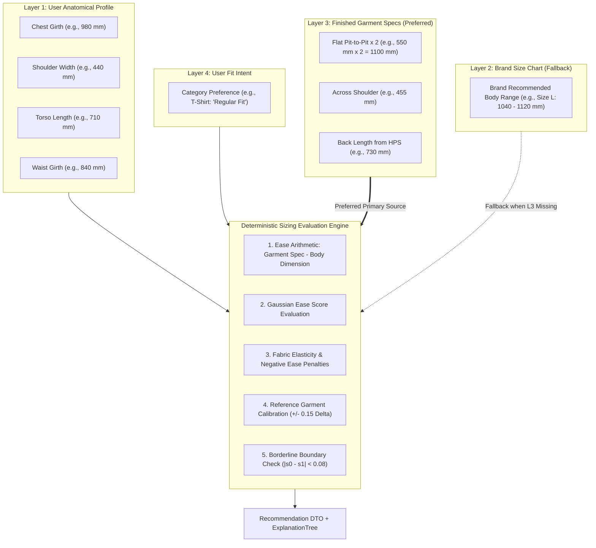
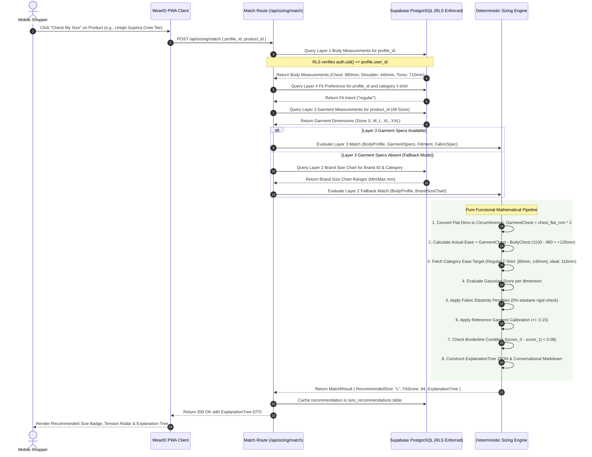
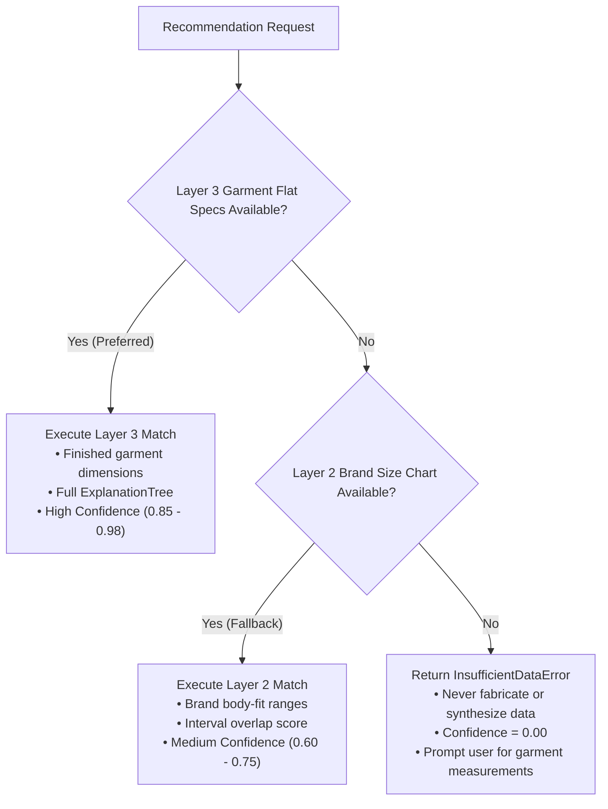
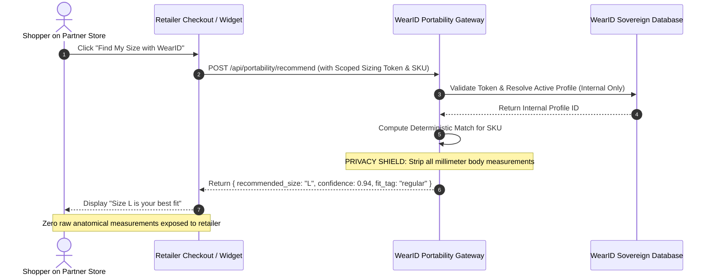

# Measurement Data Flow & Sizing Engine Architecture

> **WearID — Universal Clothing Size Profile**  
> Complete specification of domain segregation, data transformation rules, fallback mechanisms, zero-knowledge portability, and privacy boundaries across Layers 1 to 4.

---

## 1. Architectural Foundation: The 4 Non-Conflated Layers (Measurement Data Flow)

In strict adherence to **`AGENTS.md` (Invariant 3)** and **`MASTER_PROMPT.md` Product Rule 3**, body measurements and finished garment dimensions belong to completely distinct domains and must never share interchangeable columns, types, or storage entities.

---

## 2. End-to-End Recommendation Sequence Flow

The following sequence diagram illustrates the lifecycle of a size recommendation request:

---

## 3. Data Transformation Rules & Mathematical Invariants

### 3.1 Canonical Unit Normalization
- **Rule:** All internal storage, database constraints, and engine calculations operate exclusively in **non-negative integer millimeters (`mm`)** for lengths and **integer grams (`g`)** for masses.
- **Ingestion Transformation:**
  - Inches to Millimeters: $\text{Value (mm)} = \text{round}(\text{Value (in)} \times 25.4)$
  - Centimeters to Millimeters: $\text{Value (mm)} = \text{round}(\text{Value (cm)} \times 10)$
- **Presentation Transformation:**
  - Millimeters to Centimeters: $\text{Display (cm)} = \frac{\text{Value (mm)}}{10}$
  - Millimeters to Inches: $\text{Display (in)} = \frac{\text{Value (mm)}}{25.4}$

### 3.2 Flat Dimension to Circumference Transformation
Finished garment specifications are recorded laid flat across the textile.
$$\text{Garment Chest Circumference (mm)} = \text{chest\_flat\_mm} \times 2$$
$$\text{Garment Waist Circumference (mm)} = \text{waist\_flat\_mm} \times 2$$

### 3.3 Dynamic Ease Arithmetic (Ease Formula)
The foundational Ease Formula calculates the difference between garment spec and anatomical body dimension:
$$\text{Ease Formula: Ease} = \text{Garment Dimension} - \text{Body Dimension}$$
$$\text{Actual Chest Ease (mm)} = \text{Garment Chest Circumference (mm)} - \text{Body Chest Girth (mm)}$$
$$\text{Actual Shoulder Delta (mm)} = \text{Garment Shoulder Width (mm)} - \text{Body Biacromial Width (mm)}$$

### 3.4 Category Target Ease Ranges (Men's T-Shirts)
Ease intervals are calibrated based on apparel pattern engineering standards:

| Fit Intent | Min Ease | Max Ease | Ideal Midpoint ($\mu$) | Standard Deviation ($\sigma$) |
|:---|:---:|:---:|:---:|:---:|
| **Slim Fit** | `40 mm` (`4.0 cm`) | `80 mm` (`8.0 cm`) | `60 mm` (`6.0 cm`) | `15 mm` |
| **Regular Fit** | `80 mm` (`8.0 cm`) | `140 mm` (`14.0 cm`) | `110 mm` (`11.0 cm`) | `20 mm` |
| **Relaxed Fit** | `140 mm` (`14.0 cm`) | `200 mm` (`20.0 cm`) | `170 mm` (`17.0 cm`) | `25 mm` |
| **Oversized Fit** | `200 mm` (`20.0 cm`) | `300 mm` (`30.0 cm`) | `250 mm` (`25.0 cm`) | `35 mm` |

---

## 4. Fallback Hierarchy & Graceful Degradation

1. **Primary Evaluation (Layer 3):** When physical garment specifications are present, the engine executes Gaussian ease scoring against finished dimensions. Yields highest confidence ($0.85 - 0.98$).
2. **Secondary Fallback (Layer 2):** When physical garment specs are absent, the engine falls back to brand body-fit ranges. Scores are calculated based on where the user's measurement falls within the brand's recommended range:
   $$\text{Score} = 1.0 - \frac{|\text{BodyChest} - \text{RangeMidpoint}|}{\text{RangeMax} - \text{RangeMin}}$$
   Confidence is capped at $0.75$, and the UI explicitly indicates: *"Based on brand generic size guide; physical garment dimensions unavailable."*
3. **Data Absence Guardrail:** If neither Layer 3 nor Layer 2 data exists, or if the user's mandatory chest measurement is absent, the engine aborts calculation. In strict adherence to **`AGENTS.md` Invariant 1**, the engine **never fabricates or guesses plausible-looking dimensions**.

---

## 5. Zero-Knowledge Retailer Portability & Privacy Boundaries

WearID enforces strict cryptographic boundaries between private biometric profiles and external commercial entities:

### Privacy & Governance Guarantees:
1. **Private by Default (`AGENTS.md` Invariant 7):** Human body dimensions are sensitive biometrics. Raw measurements are accessible only by the authenticated owner (`auth.uid() = user_id`).
2. **Zero Biometric Leakage:** Retailer integration endpoints (`/api/portability/recommend`) transmit exclusively high-level sizing advice (recommended size tag, confidence score, qualitative drape tag). Raw chest, waist, shoulder, or height millimeters are completely stripped.
3. **Consent-Gated Profiles:** Secondary family profiles (partner, children, parents) require explicit consent flags (`consent_granted = true`) before sizing matches can be generated.
4. **Permanent Purge Support (DPDP Compliance):** Account deletion triggers an immediate cascade delete across all personal biometric tables, ensuring right-to-be-forgotten compliance.
