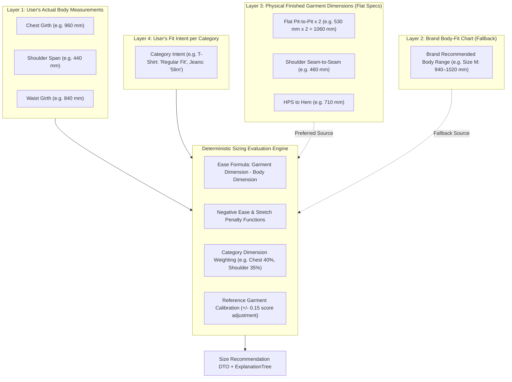

# docs/data-flow.md — Measurement Data Flow (Layers 1 $\rightarrow$ 4)

> **Fit / WearID — Universal Clothing Size Profile**  
> Complete specification of data transformation, domain segregation, ease calculation, and state transition between the four distinct layers.

---

## 1. The Four Non-Conflated Data Layers

---

## 2. Ease Calculation & Mathematical Boundaries

### 2.1 Formula for Layer 3 (Garment Measurements)
$$\text{Garment Chest Circumference} = \text{chest\_flat\_mm} \times 2$$
$$\text{Chest Ease} = \text{Garment Chest Circumference} - \text{Body Chest Circumference}$$

### 2.2 Expected Ease Ranges by Fit Type (Men's T-Shirts)

| Fit Intent | Target Ease Range (mm) | Target Ease Range (cm) | Ideal Midpoint |
| :--- | :--- | :--- | :--- |
| **Slim** | `40 mm – 80 mm` | `4.0 cm – 8.0 cm` | `60 mm` (`6.0 cm`) |
| **Regular** | `80 mm – 140 mm` | `8.0 cm – 14.0 cm` | `110 mm` (`11.0 cm`) |
| **Relaxed** | `140 mm – 200 mm` | `14.0 cm – 20.0 cm` | `170 mm` (`17.0 cm`) |
| **Oversized** | `200 mm – 300 mm` | `20.0 cm – 30.0 cm` | `250 mm` (`25.0 cm`) |

### 2.3 Ease Scoring Function
$$\text{Ease Score} = \exp\left( - \frac{(\text{Ease} - \text{Midpoint})^2}{2 \times \sigma^2} \right)$$
- If $\text{Ease} < 0$ on rigid fabric (0% elastane), $\text{Score} = 0.0$ (Strict Rejection).
- If $\text{Ease} < 0$ on stretch fabric ($\ge 5\%$ elastane), $\text{Score}$ scales with compression tolerance.
