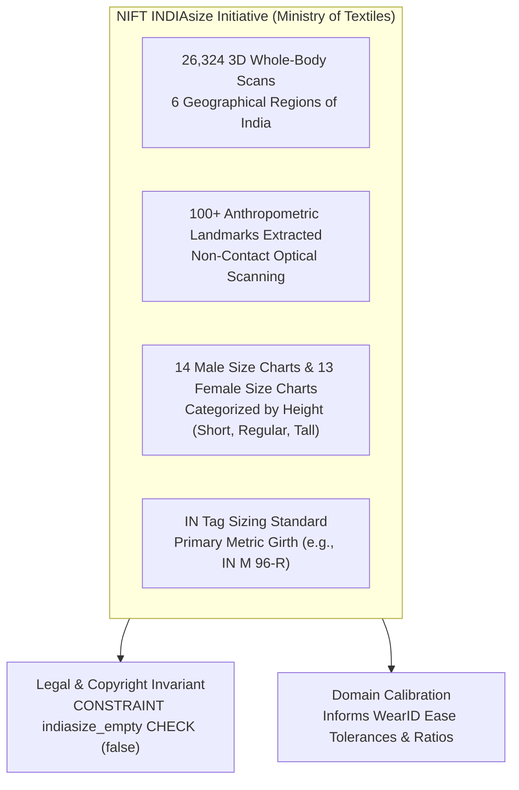
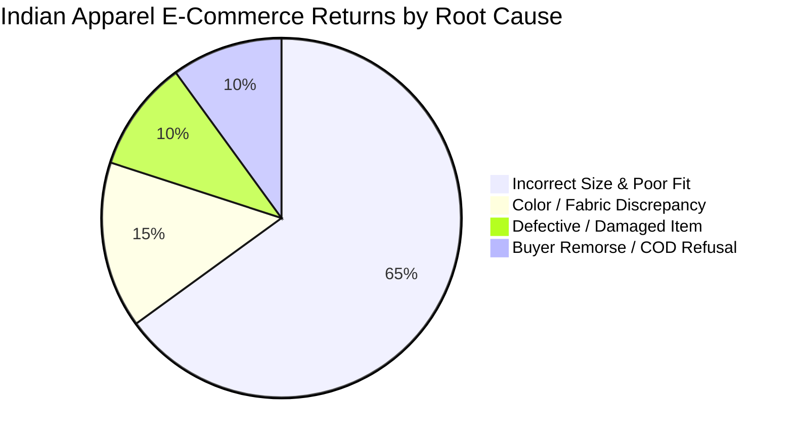

# Indian Anthropometrics & Apparel Sizing Landscape

> **WearID — Universal Clothing Size Profile**  
> Empirical research into Indian anthropometrics, the NIFT INDIAsize initiative, sizing discrepancies across retail segments, return economics, and regulatory/licensing standards.

---

## 1. The Indian Anthropometric Reality & Morphological Divergence

For over seven decades following independence, the Indian apparel manufacturing industry relied almost exclusively on pattern blocks and grading rules imported directly from the United Kingdom (British Standards Institution BSI), the United States (ASTM International), or the European Union (EN 13402). These sizing standards were developed using population anthropometry from predominantly Caucasian, Northern European, and North American demographic cohorts.

Extensive anthropometric surveys and 3D body scanning research reveal stark morphological divergences between Indian body archetypes and Western pattern templates:

### 1.1 Torso vs. Leg Proportion (Torso Length vs. Inseam Proportions)
- **Sitting Height Ratio:** Indian adults exhibit a statistically higher sitting-height-to-stature ratio compared to Northern European populations. That is, given two individuals of identical total height (e.g., 175 cm), the Indian individual typically possesses a longer torso and shorter legs (lower extremities).
- **Practical Garment Impact:** Western-graded trousers, jeans, and chinos routinely feature inseams that are 40 mm to 75 mm too long for Indian shoppers, requiring costly alterations. Conversely, standard Western casual shirts and tees often run short in the body length for taller Indian men, riding up when seated.

### 1.2 Waist-to-Hip Ratios & Central Adiposity
- **Abdominal Morphology:** Indian genetic and lifestyle predispositions result in a higher prevalence of central adiposity (visceral fat accumulation around the waist and abdomen) relative to overall body mass index (BMI).
- **V-Shape Taper Failure:** Standard Western men's pattern blocks assume an "athletic drop" of 14 cm to 18 cm between chest and waist circumference (e.g., a 100 cm chest tapering to an 84 cm waist). When Indian men purchase these garments, the shirt or jacket pinches severely across the stomach and lower button stance.
- **The "Size-Up" Compromise:** To relieve waist constriction, Indian shoppers are forced to purchase one or two sizes larger. This creates severe fit defects in other anatomical zones: billowing shoulders, gaping necklines, and sagging armholes.

### 1.3 Shoulder Width & Arm Length (Shoulder Span & Sleeve Length)
- **Biacromial & Arm Span Measurements:** Average shoulder width (biacromial diameter) and sleeve crown-to-cuff lengths in Indian adults average **20 mm to 40 mm shorter** than Western sizing blocks for an equivalent chest girth.
- **Example:** A standard UK/US Size 40 (Medium/Large) formal shirt typically provides a 640 mm sleeve length and 460 mm shoulder seam-to-seam span. The average Indian male with a 100 cm (40-inch) chest requires an optimal sleeve length of 610 mm to 620 mm and a shoulder width of 435 mm to 445 mm. Off-the-rack Western garments inevitably pool at the wrists and drop off the shoulder slope.

---

## 2. NIFT INDIAsize Programme & The IN Tag Standard

To address decades of sizing friction, the **Ministry of Textiles, Government of India**, sanctioned and funded the landmark **INDIAsize** research project, executed by the **National Institute of Fashion Technology (NIFT)** in academic partnership with global anthropometric consortia.



### 2.0 Standardized Size Classifications
The study formulated **14 distinct male size charts** and **13 female size charts**, creating the foundation for the standardized **IN Tag System** based on metric girth intervals.

### 2.1 Study Scope, Scale & Methodology
- **Demographic Sample:** **26,324 individual subjects** comprehensively scanned across diverse socioeconomic, age, and urban/semi-urban strata.
- **Geographical Distribution (6 Distinct Regions):**
  1. **North:** New Delhi, Haryana, Punjab, Uttar Pradesh.
  2. **South:** Bengaluru, Chennai, Hyderabad, Kochi.
  3. **East:** Kolkata, Patna, Bhubaneswar.
  4. **West:** Mumbai, Ahmedabad, Pune, Surat.
  5. **Central:** Bhopal, Indore, Nagpur.
  6. **Northeast:** Guwahati, Shillong.
- **Scanning Technology:** High-resolution 3D whole-body optical and infrared scanners capturing over 100 individual anatomical landmarks per subject within seconds, eliminating manual tape parallax errors.

### 2.2 Standardized Output: 14 Male and 13 Female Body Size Charts
Rather than forcing a single nationwide average, the INDIAsize empirical dataset established a multi-dimensional matrix:
- **14 Male Size Charts:** Structured across 3 primary height tiers:
  - *Short:* Height $<165$ cm.
  - *Regular:* Height $165 \text{ cm} - 175$ cm.
  - *Tall:* Height $>175$ cm.
  Combined with chest girth intervals spaced at 4.0 cm increments (e.g., 88 cm, 92 cm, 96 cm, 100 cm, 104 cm, 108 cm, 112 cm).
- **13 Female Size Charts:** Structured across height classifications and bust/waist/hip girth profiles, acknowledging diverse regional pear, hourglass, and rectangle silhouette distributions.

### 2.3 The IN Tag Sizing Standard
- **Metric Girth Nomenclature:** The IN Tag standard replaces arbitrary, unstandardized vanity alpha tags (S, M, L, XL) with direct metric body girths in centimeters.
- **Composite Size Code Format:** 
  $$\text{Standard Code} = \text{System} + \text{Gender} + \text{Primary Girth (cm)} + \text{Height Bracket}$$
  *Example:* `IN M 96-R` designates an Indian Male profile with a **96 cm chest circumference** and a **Regular height profile** (165–175 cm).
- **Launch Timeline:** The official public launch and portal opening of INDIAsize commenced on **2 January 2026**, initiating voluntary adoption cycles among domestic apparel manufacturers.

### 2.4 Legal, Licensing & Database Invariant (CRITICAL)
- **Copyright Ownership:** The raw scanning datasets, numerical tables, and dimensional charts produced by the INDIAsize project are the exclusive intellectual property of the **Ministry of Textiles, Government of India**, and NIFT.
- **Hard Rule for WearID (`AGENTS.md` Invariant 1 & 2):** Under no circumstance will WearID scrape, mirror, or ingest unverified or unauthorized copies of the proprietary INDIAsize database tables without an official, written commercial licensing agreement.
- **Database Schema Enforcement:**
  In `docs/database-schema.sql`, the `indiasize_reference` table is permanently protected by an impossible database check constraint:
  ```sql
  CREATE TABLE indiasize_reference (
      id UUID PRIMARY KEY DEFAULT uuid_generate_v4(),
      gender gender_type NOT NULL,
      height_category TEXT NOT NULL,
      chest_cm NUMERIC(4,1) NOT NULL,
      waist_cm NUMERIC(4,1) NOT NULL,
      hip_cm NUMERIC(4,1) NOT NULL,
      tag_label TEXT NOT NULL,
      sample_size INTEGER NOT NULL,
      -- CRITICAL LEGAL INVARIANT: Prevents unauthorized ingestion of proprietary tables
      CONSTRAINT indiasize_empty CHECK (false)
  );
  ```
- **Permitted Use of Domain Knowledge:** WearID leverages public, published academic insights (such as average torso-to-inseam ratios, shoulder span differentials, and Gaussian variance parameters) to refine its deterministic ease curves and category weighting matrices without redistributing copyrighted data assets.

---

## 3. Comparison of Global & Regional Sizing Systems

The following matrix illustrates how the emerging Indian standard compares against legacy international sizing frameworks:

| Sizing Dimension | India (IN Tag Standard) | United Kingdom (UK / BSI) | United States (US / ASTM) | European Union (EU / EN 13402) |
| :--- | :--- | :--- | :--- | :--- |
| **Primary Metric** | Centimeters (cm) | Inches (in) / Alpha tags | Inches (in) / Alpha tags | Centimeters (cm) |
| **Men's Chest Base** | 88, 92, 96, 100, 104, 108 cm | 36, 38, 40, 42, 44, 46 in | 36, 38, 40, 42, 44, 46 in | 44 (88cm), 46 (92cm), 48 (96cm), 50 (100cm) |
| **Grading Step (Chest)** | **4.0 cm (~1.57 in)** | **2.0 in (5.08 cm)** | **2.0 in (5.08 cm)** | **4.0 cm (1.57 in)** |
| **Waist Drop (Chest - Waist)** | **10–12 cm** (Realistic Indian drop) | **14–16 cm** (Standard athletic taper) | **12–15 cm** (Commercial standard) | **12–16 cm** (Tailored European taper) |
| **Sleeve Length Baseline** | Calibrated 20–40mm shorter | Longer crown-to-cuff span | Standard long arm span | Standard European arm span |
| **Height Segmentation** | Short (<165), Reg (165-175), Tall (>175) | Regular, Long (selective) | Short, Regular, Long | Body height ranges (164, 170, 176, 182) |
| **Women's Sizing Base** | Bust & Waist girth in cm | Dual numeric tags (8, 10, 12, 14) | Even numeric tags (2, 4, 6, 8, 10) | Double-digit tags (34, 36, 38, 40) |

---

## 4. Indian E-Commerce Return Economics & Sizing Chaos

Apparel e-commerce in India is severely undermined by high return volumes and reverse-logistics expenses.



### 4.1 Return Rates & Fit Dissatisfaction
- **Industry Return Rate:** E-commerce return rates in Indian fashion average **25% to 40%**, with Cash-on-Delivery (COD) orders routinely exceeding **45%**.
- **Size as Primary Culprit:** Consumer surveys and return-processing logistics indicate that **60% to 70% of all fashion returns are directly caused by sizing mismatch, unflattering drape, or tight restriction**.

### 4.2 The "Bracketing" Behavioral Trap
- **Consumer Behavior:** Because sizing charts are perceived as unreliable, more than **30% of frequent online fashion shoppers admit to "bracketing"**—ordering 2 or 3 adjacent sizes of the exact same garment (e.g., ordering both Size M and Size L) with the upfront intention of keeping only one and returning the rest.
- **Logistical Impact:** Bracketing doubles or triples outbound shipping volume while guaranteeing at least a 50% to 66% return rate on every bracketing transaction.

### 4.3 Reverse Logistics Unit Economics
The economic cost of an apparel return in India is devastating to merchant margins:
- **Direct Reverse Shipping Cost:** ₹70 to ₹120 per package (reverse pick-up, surface/air transit).
- **Inspection, Quality Check & Steaming/Refurbishment:** ₹30 to ₹60 per returned unit.
- **Restocking & Inventory Lock-up Depreciation:** ₹20 to ₹70 in lost seasonal margin.
- **Total Reverse Logistics Cost:** **₹120 to ₹250 per return event**.
- For a value t-shirt retailing at ₹499 to ₹799, a single return completely eliminates net operating margin and results in an operational loss.

---

## 5. Current Brand Operational Approaches in India

Our empirical brand audit identifies four distinct sizing strategies operating in the Indian retail market today:

### 5.1 International Fast-Fashion Importers (e.g., Zara, H&M, Uniqlo)
- **Characteristics:** Primarily retain master pattern blocks designed in Spain, Sweden, or Japan.
- **Sizing Reality:** Zara and H&M garments run 1 to 2 sizes larger than domestic Indian brands. Uniqlo stands out as the global gold standard by publishing explicit **Layer 3 finished garment measurements** (flat pit-to-pit, body length, shoulder width) on its Indian e-commerce platform.

### 5.2 Domestic Heritage Formalwear (e.g., Raymond, Van Heusen, Peter England)
- **Characteristics:** Rooted in British bespoke tailoring traditions. Shirts are graded strictly by collar circumference in centimeters (38, 39, 40, 42, 44) and chest, while trousers are graded by waist circumference in inches (30, 32, 34, 36).
- **Sizing Reality:** Very high internal consistency across their own collections, but their slim/custom cuts create massive fit friction when consumers attempt to cross-shop casual t-shirts and streetwear.

### 5.3 Value Retail Giants (e.g., Westside, Max Fashion, Zudio, Reliance Trends)
- **Characteristics:** Cater to mass-market Indian demographics across Tier 1, 2, and 3 cities.
- **Sizing Reality:** Systematically employ **vanity sizing** and generous wearing ease (+12 cm to +18 cm on chest circumferences) to maximize fit acceptance across broader waistlines. A "Size Medium" at Westside often possesses a finished garment circumference matching a "Size Large" at Zara.

### 5.4 D2C Streetwear & Youth Brands (e.g., Snitch, The Souled Store, Bewakoof)
- **Characteristics:** Dominated by relaxed, boxy, drop-shoulder, and oversized silhouettes popular among Gen Z and millennial shoppers.
- **Sizing Reality:** An "Oversized Medium" t-shirt from Snitch frequently measures **116 cm** in finished chest circumference—substantially larger than a Van Heusen formal shirt in Size XL (112 cm).
- **Core Architectural Takeaway:** This extreme divergence proves that **Garment Specs (Layer 3) and Fit Preferences (Layer 4) must never be conflated with Body Dimensions (Layer 1)**.

---

## 6. Collaboration Potential with NIFT & Industry Roadmap

WearID is positioned as the independent, consumer-facing implementation layer for standardized sizing in India:
1. **Academic Partnership:** Establishing dialogue with NIFT researchers to validate WearID's Gaussian ease curves against aggregate non-proprietary anthropometric distributions.
2. **Promoting IN Tag Adoption:** Assisting D2C merchants and independent apparel brands in migrating from legacy vanity sizing to standardized metric girth labels.
3. **Formal Licensing Pathway:** Once Phase 1 proof-of-concept milestones are established, WearID will evaluate formal outreach for a verified, licensed integration of the INDIAsize benchmark tables.
