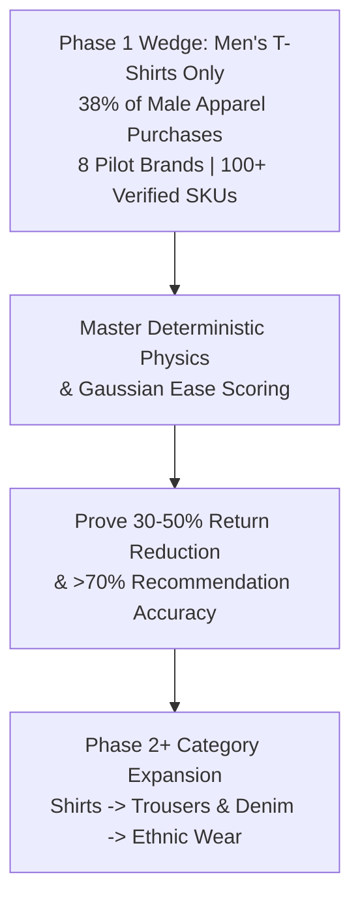
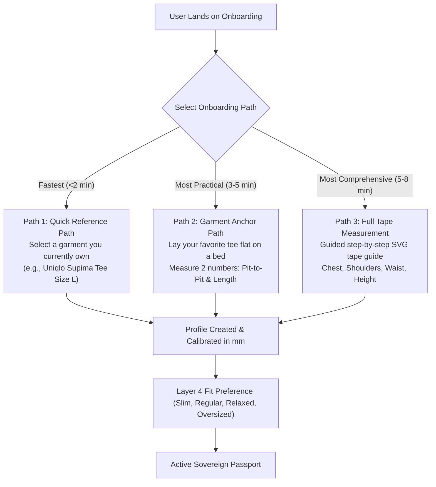
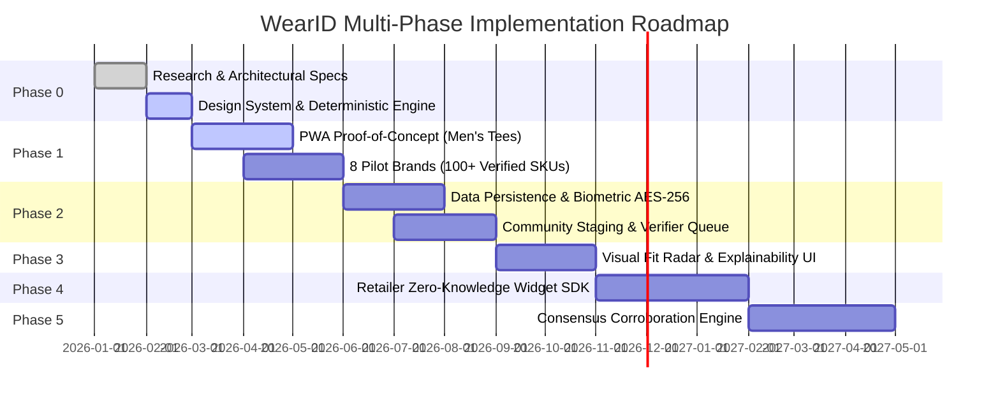

# Product Strategy & Strategic Opportunities

> **WearID — Universal Clothing Size Profile**  
> Market opportunity analysis, value creation models, the Men's T-Shirt Wedge Strategy, 3-path progressive onboarding architecture, and roadmap alignment.

---

## 1. The Core Value Proposition: Universal Sizing Passport

> **"ONE PROFILE. EVERY BRAND. A BETTER FIT."**

The modern consumer shops across dozens of fragmented apparel channels: international fast-fashion websites, domestic department stores, venture-backed D2C labels, multi-vendor marketplaces, and bespoke neighborhood tailors. In each store, they face a different sizing paradigm, an ambiguous size chart, and the persistent anxiety of receiving an ill-fitting garment.

WearID re-architects this broken experience by introducing the **Universal Sizing Passport**: a sovereign digital identity that decouples biological human measurements from brand vanity sizing with complete cross-store Portability. By maintaining strict mathematical separation across four distinct data layers, WearID transforms fit from a guessing game into an exact science with Zero Hallucination, Zero biometric leakage, and absolute Privacy-by-default.

---

## 2. Multi-Stakeholder Value Creation Models

WearID delivers substantial, quantifiable value across the entire fashion-tech ecosystem:

### 2.1 Consumer Value
1. **Single Source of Truth:** Measure once (using guided tape, garment anchor, or reference selection) and never decipher a confusing brand size chart again.
2. **Elimination of Bracketing & Return Fatigue:** Shoppers eliminate the financial friction of ordering multiple sizes, waiting for refunds, and repacking return parcels.
3. **Multi-Profile Family Hub:** Create and curate individual profiles for spouses, children, elderly parents, and friends. Enables seamless, confident gift shopping without asking awkward measurement questions.
4. **Tailor & WhatsApp Portability:** Instantly generate clean, printable spec cards and WhatsApp-shareable QR codes for bespoke tailors, custom suit makers, and ethnic wear boutiques.
5. **Absolute Privacy:** The user's biometric dimensions are private by default; third-party merchants receive deterministic size recommendations (`"Size Large fits best (94% confidence)"`), never raw anatomical dimensions. Zero biometric leakage is guaranteed.

### 2.2 Brand / Merchant Value
1. **Dramatic Return Rate Reduction:** Sizing drives 60% to 70% of fashion returns. By matching garments based on finished dimensions and ease tolerances, brands can cut return volumes by **30% to 50%**.
2. **Direct Margin Preservation:** Eliminating an apparel return saves the merchant **₹120 to ₹250** in direct shipping, inspection, refurbishment, and inventory depreciation expenses.
3. **Zero Hallucination Assurance:** Every recommendation is explainable and verifiable.

---

## 3. The Wedge Strategy: Men's T-Shirts
Our initial Wedge Strategy focuses exclusively on Men's T-shirts across 8 pilot brands.
3. **Checkout Conversion Acceleration:** Size uncertainty is the leading driver of online cart abandonment. Providing an instant, explainable recommendation with confidence indicators converts hesitant window shoppers into buyers.
4. **Actionable Pattern Analytics:** Anonymized, aggregate fit feedback provides merchant design teams with unprecedented clarity: e.g., *"42% of Indian customers find the chest on SKU #4092 tight, but the shoulders loose."*

### 2.3 Marketplace & Ecosystem Value Model
1. **Normalized Sizing Metadata:** Marketplaces (like Myntra or AJIO) gain a consistent, canonical schema for cross-brand comparisons.
2. **Zero-Knowledge Integration ("WearID Connect"):** Retailers can integrate sizing widgets via an ephemeral sizing token without storing or processing sensitive user biometrics, complying with the Digital Personal Data Protection (DPDP) Act.
3. **National Standard Dissemination:** Accelerates commercial adoption of the Ministry of Textiles' IN Tag standard by translating legacy sizing tables into metric girth ratings.

---

## 3. The Wedge Strategy: Men's T-Shirts Only for Phase 1

A common mistake in apparel tech is attempting to solve every clothing category simultaneously (jeans, suits, sarees, bras, footwear). This dilutes data quality and increases edge-case complexity.

WearID employs a tightly focused **Wedge Strategy** for Phase 1:

### 3.1 Strategic Rationale for Men's T-Shirts
1. **Dominant Volume:** T-shirts represent **38% of all male online apparel transactions** in India. They are the high-frequency gateway to consumer e-commerce.
2. **Highest Silhouette Variance:** The t-shirt category exhibits the most dramatic divergence in garment cut—ranging from ultra-fitted muscle tees and standard regulars to boxy, drop-shoulder, and streetwear oversized fits.
3. **Fewer Anthropometric Variables:** Unlike trousers (which require waist, hip, rise, thigh, and inseam) or formal blazers (requiring chest, shoulder, bicep, sleeve, and waist), a t-shirt fit is primarily governed by **three key dimensions**:
   - Chest circumference / flat pit-to-pit (Primary, 40% weight).
   - Shoulder seam-to-seam span (Secondary, 35% weight).
   - Garment body length (Tertiary, 15% weight).
4. **Defensible Data Baseline:** Mastering one vertical slice completely with 100+ verified records creates an unshakeable foundation before expanding into complex categories.

### 3.2 The 8 Phase 1 Pilot Brands
The pilot footprint covers the complete spectrum of Indian consumer shopping habits:
1. **Uniqlo India** (Technical apparel / Global gold standard for Layer 3 garment flat specs).
2. **H&M India** (Fast-fashion mass volume; European grading).
3. **Zara India** (Fast-fashion trend leader; European slim/tailored cut).
4. **Van Heusen / Raymond** (Heritage formal and smart-casual domestic brands).
5. **Westside** (Tata Trent department store; generous Indian wearing ease).
6. **Max Fashion** (Landmark Group mass market; Tier 2/3 value retail).
7. **Snitch** (D2C youth streetwear leader; relaxed and oversized cuts).
8. **Levi's India** (Denim & casualwear benchmark).

### 3.3 Quantitative Phase 1 Validation Thresholds
- **Verified SKUs:** Minimum **100+ verified Men's T-shirt SKU records** with both Layer 2 and Layer 3 dimensions populated.
- **Accuracy Verification:** $>70\%$ positive feedback ("Fits as expected") on post-purchase feedback loops.
- **Onboarding Completion:** $>60\%$ completion rate on initial onboarding across all user cohorts.

---

## 4. The 3-Path Progressive Onboarding Architecture

User friction during onboarding is the primary reason past sizing startups failed. Forcing an immediate 15-minute tape measurement or mandatory video body scan results in 70%+ user drop-off.

WearID implements a **3-Path Progressive Disclosure Onboarding Model**:

### 4.1 Path 1: The Quick Reference Path ($<2$ Minutes)
- **Target User:** Casual or hurried shoppers seeking an immediate recommendation without reaching for a measuring tape.
- **Workflow:**
  1. The user selects a pilot brand and product they already own and wear comfortably (e.g., *Uniqlo U Crew Neck Tee* in *Size L*).
  2. The user rates how that item currently fits (*"Fits Perfect"*, *"Slightly Tight"*, *"Slightly Loose"*).
  3. WearID retrieves the verified Layer 3 flat specs of that benchmark garment (Chest flat: 550 mm $\rightarrow$ 1100 mm circumference).
  4. Back-calculates the user's estimated anatomical chest assuming standard regular ease (1100 mm $- 110$ mm ease $= 990$ mm estimated body chest).
  5. The profile is marked as `confidence: medium` and is immediately functional for exploration.

### 4.2 Path 2: The Garment Anchor Path (3–5 Minutes)
- **Target User:** Pragmatic shoppers who do not want to measure their own bodies, but own a favorite, best-fitting t-shirt.
- **Workflow:**
  1. Prompts the user to lay their best-fitting t-shirt flat on a bed or table.
  2. The user takes a standard tape or ruler and inputs just **two simple measurements**:
     - **Pit-to-pit flat width** across the chest (e.g., $53$ cm).
     - **Collar-to-hem length** from highest shoulder point (e.g., $71$ cm).
  3. Converted instantly to canonical millimeters ($530$ mm flat chest $\rightarrow 1060$ mm finished chest circumference).
  4. Stores the garment as a verified reference anchor and establishes the baseline for all future recommendations.

### 4.3 Path 3: The Full Measurement Path (5–8 Minutes)
- **Target User:** Enthusiasts, individuals with non-standard body proportions, or shoppers preparing for bespoke tailoring.
- **Workflow:**
  1. Step-by-step guided visual measurement wizard with animated inline SVG illustrations (no jarring popups).
  2. Prompts for:
     - Chest circumference (around the fullest part of the chest).
     - Across-shoulder span (seam-to-seam across the upper back).
     - Torso length (base of back collar to waistband).
     - Stature / Total height (for height bracket matching).
  3. Live unit toggling (`cm` $\leftrightarrow$ `in`) with real-time canonical integer millimeter conversion.
  4. Yields a high-confidence profile (`confidence: high`) suitable for instant QR export to tailors.

---

## 5. Strategic Product Roadmap

- **Phase 0:** Foundational research, competitor benchmarking, Indian anthropometrics, design tokens, mathematical ease pseudocode, and complete DDL/RLS architectural specifications.
- **Phase 1 (Current Focus):** Responsive Progressive Web App (PWA) proof-of-concept focused on Men's T-Shirts across 8 pilot brands, deterministic recommendation engine, standalone mobile manifest, and local Supabase/mock services.
- **Phase 2:** Cloud data persistence, biometric encryption, community contribution pipeline, and admin moderation queue.
- **Phase 3:** Visual tension radar charts, enhanced conversational ExplanationTrees, and family profile gifting flows.
- **Phase 4:** Embeddable merchant widget ("WearID Connect") enabling zero-knowledge sizing checks on third-party e-commerce sites.
- **Phase 5:** Multi-source consensus engine, cross-brand correlation graphs, and performance optimization ($<15$ ms recommendation latency).
