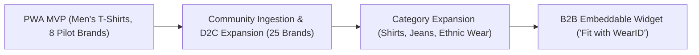

# docs/product-opportunities.md — Product Strategy & Strategic Opportunities

> **Fit / WearID — Universal Clothing Size Profile**  
> Synthesis of market gaps, competitive opportunities, pilot database thresholds, and strategic positioning.

---

## 1. Core Differentiation Pillars

Existing players in apparel sizing fail due to three fatal flaws:
1. **Opaque Black Boxes:** True Fit and marketplace algorithms recommend sizes without explaining the underlying arithmetic, leading to consumer skepticism when an item fits poorly.
2. **Conflation of Body and Garment:** Nearly all size guides treat a user's chest measurement as if it were the same as the shirt's width, ignoring ease allowance and fabric drape.
3. **Desktop & Retailer Lock-in:** Solutions are either browser extensions that don't work on mobile, or proprietary widgets walled inside a single merchant's checkout.

WearID breaks this paradigm through four pillars:

### Pillar 1: Total Mathematical Transparency & Explainability
- Every size recommendation generates a transparent **ExplanationTree**.
- The user sees: *"Your chest is 96cm. Size M provides a 106cm finished chest (+10cm ease), which matches your regular fit preference. Size L would give +16cm ease, which will feel loose across your shoulders."*

### Pillar 2: 4-Layer Separation (Anatomy vs. Garment vs. Ease vs. Preference)
- Uncompromising architectural separation between what a person's body measures (Layer 1) and how a garment is physically constructed (Layer 3).
- Allows dynamic ease modeling based on textile composition (e.g. rigid 100% cotton vs. elastane blends).

### Pillar 3: Sovereign, Mobile-First PWA Portability
- Installable directly from Chrome and Safari without app store gatekeepers.
- Works across any brand, any store, in-person tailors, and gift buying for family members.

### Pillar 4: Community-Corroborated Truth
- A transparent contribution and moderation pipeline where physical garments are measured and verified by multiple contributors, rewarding accuracy with reputation points.

---

## 2. Minimum Credible Database for Phase 1 MVP

To establish immediate credibility with real users during the Phase 1 pilot, the catalog must satisfy these quantitative thresholds:

1. **Category Focus:** **Men's T-Shirts Only.**
   - T-shirts represent 38% of male online apparel purchases in India and exhibit the highest variance in fit styles (crew, slim, regular, boxy, oversized).
   - Mastering one vertical slice completely before expanding creates a defensible quality benchmark.
2. **Pilot Brands:** **8 Brands** representing the cross-section of Indian consumer shopping habits:
   - Fast Fashion: **H&M India**, **Zara India**
   - Technical / Quality: **Uniqlo India**
   - Domestic Heritage: **Van Heusen**
   - Department Stores / Value: **Westside**, **Max Fashion**
   - Streetwear / D2C: **Snitch**
   - Denim / Casual: **Levi's India**
3. **Verified SKU Count:** Minimum **100+ verified T-shirt size records** with complete Layer 2 and Layer 3 dimension specs.
4. **Onboarding Conversion Target:** >60% onboarding completion rate via the 3-path progressive disclosure model (Quick <2 min, From Garment, Full Measurement).

---

## 3. Anthropometric Baseline Strategy (INDIAsize Status)

- **Legal Determination:** INDIAsize data **cannot** be imported directly into our database as raw tables without a formal copyright license agreement with the Ministry of Textiles / NIFT.
- **Engine Baseline:** In Phase 1, our anthropometric baseline relies on:
  - Direct user-reported measurements (Layer 1) collected via guided onboarding.
  - Empirical brand garment specifications (Layer 3) verified through physical measurements and official technical charts.
  - Mathematical ease formulas derived from standard apparel pattern making standards (ISO 8559 and British garment construction principles).
- **Future Integration:** The `indiasize_reference` table is maintained in the schema with a `CHECK (false)` constraint to guarantee zero illegal ingestion until authorization is achieved.

---

## 4. Strategic Milestones for Market Adoption

By proving recommendation accuracy (>70% user verification on "Did this fit?"), WearID establishes the trusted data network required to become the universal clothing identity standard across Indian fashion commerce.
